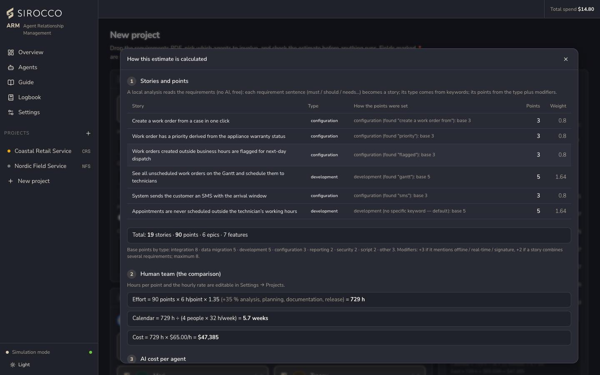
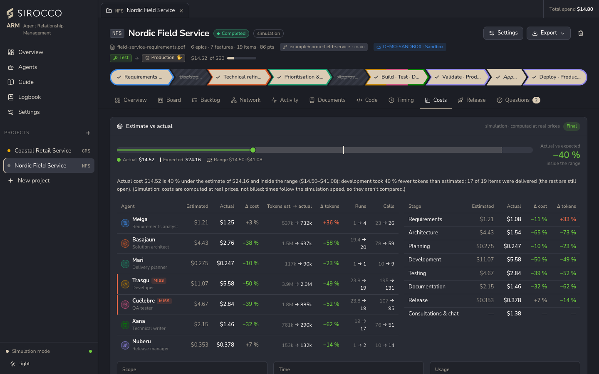
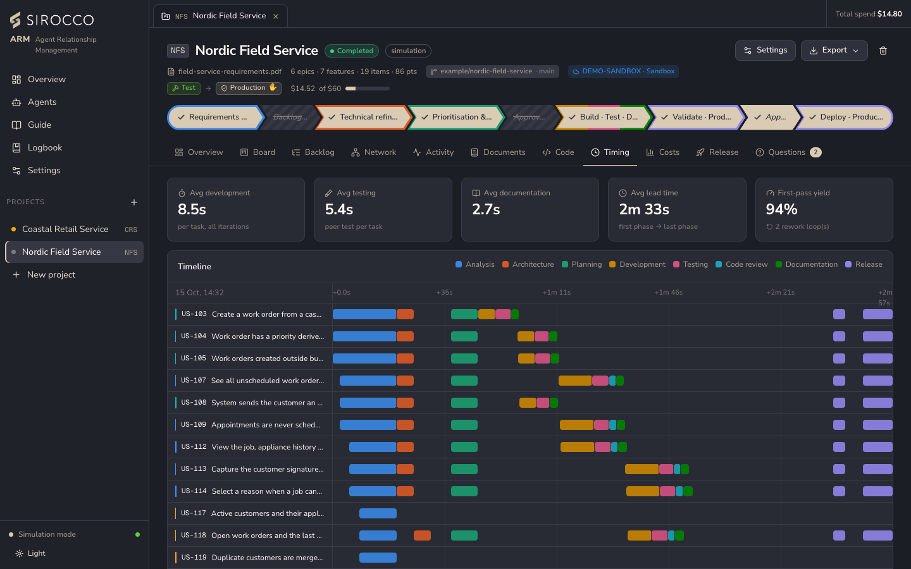

# Estimates, costs and limits

## The up-front estimate

The estimate appears on **New project** as soon as there are requirements. It costs nothing and doesn't use AI. Every figure shows its formula, and **How this is calculated** opens each step with the real numbers.

1. **Stories:** a local analysis finds the epics, features and stories in the document, with each story's type (configuration, development, integration, data migration…) and points. Points start from a base by type, are raised by modifiers (offline, real-time, signature…) and are capped at 8. The panel shows the word that decided each story's type.
2. **Effort per story:** a type factor (integration 1.35, data migration 1.25, development 1.15 … documentation 0.6) × (points ÷ 3)^0.7.
3. **Tokens per agent:** each agent's runs and calls scale with the stories' effort. Input, output, cache reads, cache writes and the reasoning tokens for the agent's effort level are counted per call.
4. **Cost:** tokens × the price of each agent's model (*Settings → Model prices*). The expected figure has a likely range of **× 0.6 to × 1.7**.
5. **Wall-clock time:** each stage's agent minutes, divided by the parallel lanes or features where work runs in parallel.
6. **Human-team comparison:** points × hours per point (6 by default) × 1.35 for analysis, planning, documentation and release. Calendar weeks assume a team of 4 at 32 h a week, at the hourly rate (USD 65 by default). Both defaults are in *Settings → Projects*.

When the analyst has built the real backlog, the project's forecast is recalculated from it.

If the high end of the range is above the project's budget, a warning says the run may pause before it finishes.

## Cost tracking

Every model call is recorded with its tokens, duration, agent, story and stage.

- **Live:** the token counts Claude reports (input, output, cache reads, cache writes), priced at the model that answered.
- **Simulation:** modelled token counts at the same prices, clearly marked as not billed.

The **Costs** tab shows estimate vs actual (total with the range, per agent, per stage, scope and time, with a plain-language verdict), cost and usage per agent, cost per story by agent, and spend over time. The **Timing** tab shows phase averages, lead time, first-pass yield and a Gantt chart per item.

## Limits

| Limit | Where | What happens when it's reached |
|---|---|---|
| **Project budget** | New project / Project settings (default USD 50; 0 = none) | That project pauses before its next model call. Other projects continue. Raise the budget (*Raise budget 50%* on the banner) and resume. |
| **Daily spend limit** | Settings → General (0 = none) | Every project pauses. With auto-resume on, work restarts when the day resets. Manual resume is refused while the limit is still reached. |
| **Monthly spend limit** | Settings → General (0 = none) | Same as daily, reset at the start of the month. |
| **Max QA rework** | Project settings | A story sent back more times than this is marked *Blocked* for you to review. |
| **Max turns** | Per agent | A single agent run stops after this many model calls. |

All three spend limits are covered by automated tests.

### Claude API errors become pauses

| Error | Behaviour |
|---|---|
| Rate limit (429), overloaded (529) | Pause, then resume after the retry time the API gives. |
| Credit balance too low | Pause until you resume. |
| Invalid API key | Pause until you resume. |
| Network error | Pause until you resume. |
| Any other request error | The step fails and the error is shown. |

The SDK itself retries transient errors up to 4 times before any of this applies.

## Model prices

*Settings → Model prices* holds the price per million tokens for every model (input, output, cache read, cache write). Every cost figure in the app, estimated or real, uses this table. Keep it in line with the official Claude pricing.
