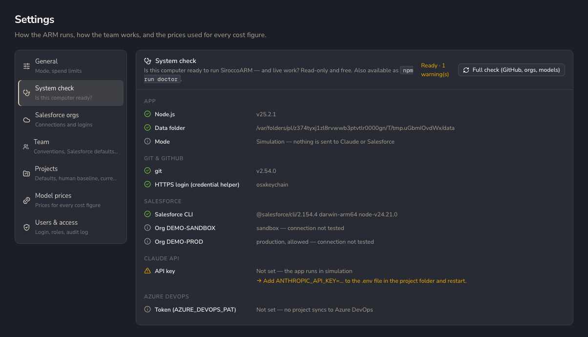
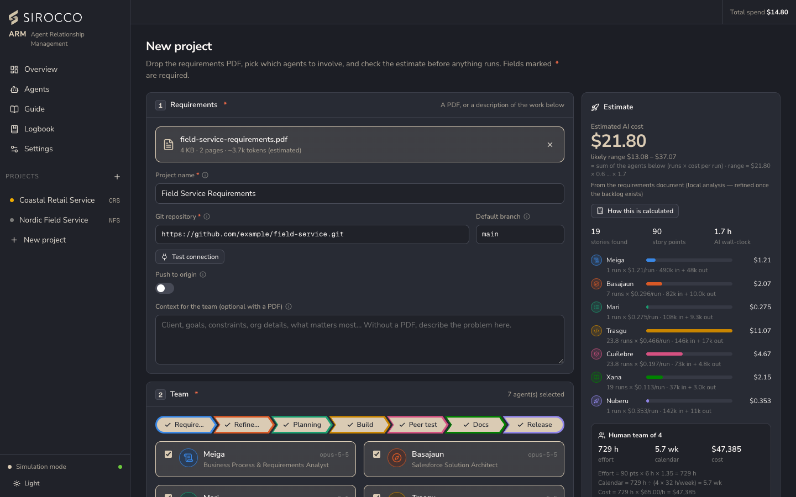

# Getting started

This page takes you from a fresh clone to a first project running in simulation, which is free and sends nothing outside your computer.

## Prerequisites

| Tool | Version | Needed for |
|---|---|---|
| Node.js | 22.5 or newer (CI uses 25) | The app. The database uses the built-in `node:sqlite`. |
| git | 2.25 or newer | Every project's repository and its per-story worktrees. |
| Salesforce CLI (`sf`) | Current | Optional. Org connections and live deploys. `npm install -g @salesforce/cli` |
| GitHub CLI (`gh`) | Current | Optional. Pull requests on GitHub repositories. |
| Google Chrome | Current | Optional. Real screenshots as QA evidence in live mode. |

## Install and run

```bash
git clone <repository-url> SiroccoARM
cd SiroccoARM
npm install
cp .env.example .env      # leave the values empty for simulation
npm start                 # builds the web app and serves everything on http://localhost:4100
```

Open <http://localhost:4100>. The badge left of **Total spend** in the top bar shows the mode; it says **Simulation**.

Then check the machine:

```bash
npm run doctor
```

The system check is read-only and free. It reports Node.js, the data folder, git and its login, the Salesforce CLI and registered orgs, the Claude API key and the Azure DevOps token, each with a fix when something is missing. The same check is in **Settings → System check**.



## Your first project

1. **New project** in the sidebar.
2. **Requirements:** drop a requirements PDF (up to 32 MB) or describe the work in *Context for the team*. Every sentence with "must", "shall" or "should" becomes a story.
3. **Git repository:** an `https://` or `git@` URL without credentials, and the default branch. *Test connection* reads the remote and dry-runs a push without changing it. *Push to origin* is off by default; with it off, everything stays local.
4. **Team:** keep all seven agents ticked.
5. **Run settings:** keep the approval gates on.
6. Read the **estimate** on the right (cost range, time, human-team comparison), then **Create & start**.



The project opens in its own tab. Meiga builds the backlog, then the pipeline stops at the first gate, **Backlog review**. Approve it to continue. Follow the work on the **Board**, **Network**, **Timing** and **Costs** tabs.

## Development mode

```bash
npm run dev     # web on http://localhost:5173 with hot reload, API on :4100
```

See [Development](Development.md) for tests, typechecking and CI.

## Next steps

- [How it works](How-It-Works.md): the pipeline and what each gate is for.
- [Going live](Going-Live.md): the checklist before using the real Claude API.
