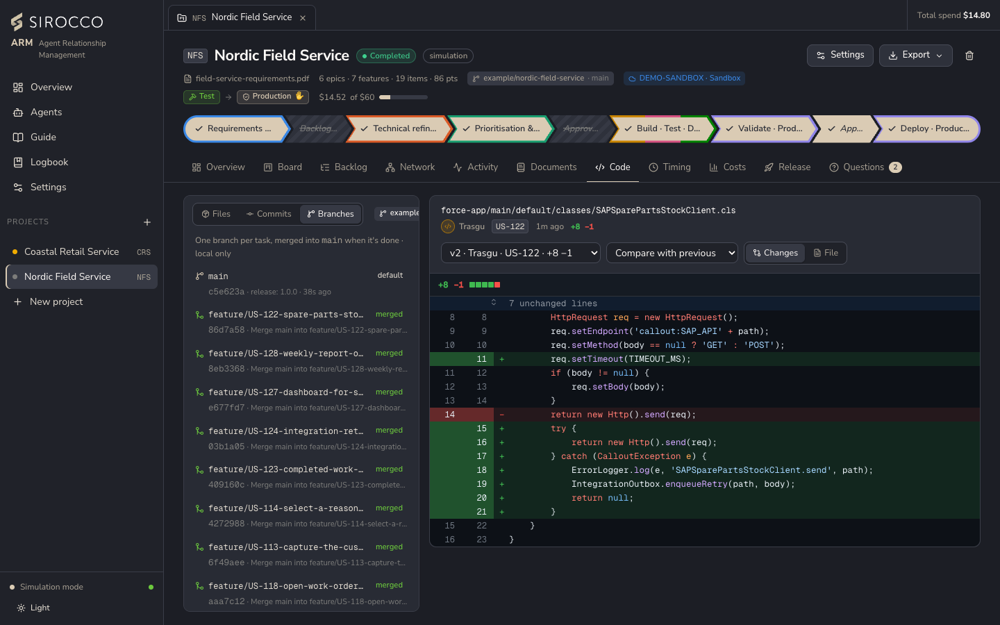

# Git and pull requests

Every project's workspace is a real git repository (`data/projects/<KEY>/workspace`) with the project's URL as `origin`. Agents work like a disciplined team: one branch per task, one commit per run, merged when done.

## Branches and commits

- **One branch per task:** each story or bug gets its own branch (`feature/US-103-…`, `bugfix/BG-120-…`, following the team's branch pattern) and its own working copy, a git worktree under `data/projects/<KEY>/worktrees/`. Parallel lanes never write into the same folder.
- **Commits per agent run:** development, QA and documentation runs commit on the task branch, authored by the agent (for example `Trasgu <trasgu@siroccoarm.local>`). Project-level documents stay on the default branch.
- **Merge:** once the task is documented, the default branch is merged into the task branch first, then the task is merged with a merge commit. On conflicts, live mode asks the developer to resolve them (the merge is refused while conflict markers remain); simulation keeps the task's version. Merged branches stay as history.
- **Releases** are tagged on the default branch (`v1.0.0`).

## Pushing

*Push to origin* is off by default per project. When on, task branches are pushed as agents commit, the default branch after each merge and tags after each release. Pushing uses this computer's own git login: the credential helper for `https://` URLs, the SSH key for `git@` URLs. Repository URLs that contain a user name, password or token are refused.

*Test connection* in the project reads the remote and dry-runs a push; nothing on the remote changes.

Pushing also happens in simulation when the project opts in, so a demo can show real branches on the remote.

## GitHub pull requests

When a project pushes to a GitHub repository, each story gets a pull request:

1. It opens as a **draft** when the developer first hands the story to QA.
2. QA's findings and verdict are posted as comments (GitHub doesn't let an account approve its own PR).
3. The architect's code review, when enabled, is posted as a comment.
4. The PR is merged on GitHub once the story is documented, and the local default branch catches up.

This uses the GitHub CLI's login (`gh auth login`). If `gh` is missing, logged out or offline, the story is merged locally and pushed as before; no work is lost. The PR description and commit formats come from the team conventions (*Settings → Team*).

> Pull requests are GitHub-only. Repositories hosted elsewhere (for example Azure Repos) get branches, merges and tags, but no pull requests.

## The Code tab

- **Files:** the SFDX source tree; files that exist only on an unmerged task branch are marked.
- **Commits:** every commit with its agent and branch.
- **Branches:** default, in progress and merged, with commits ahead and a link to the PR.
- **Diff:** pick any version of a file and compare it with the previous one, any older one or an empty file.

