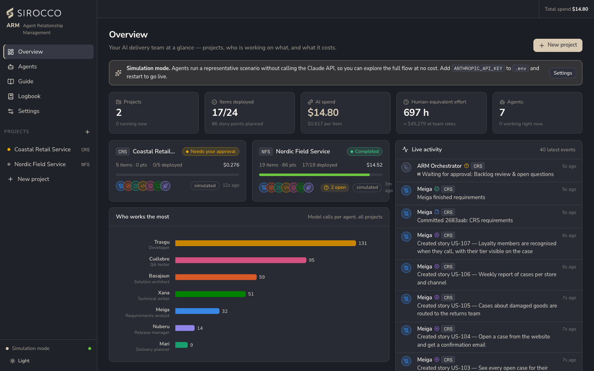

# AgentStudio — AI delivery studio

AgentStudio is a web application that runs on your own computer. In it, a team of seven AI agents takes a change to any code repository from the requirements to a tested, documented release, with you approving at every gate.

> A CRM manages your customers. An ARM manages the team of agents that delivers for them.

## What it does

| | |
|---|---|
| **From a PDF to a backlog** | The requirements analyst reads the document and builds epics, features and stories with acceptance criteria, and raises questions where the document is ambiguous. |
| **A real delivery pipeline** | Design, planning, build, peer test, code review, documentation and release, with approval gates where a person decides. |
| **Real engineering output** | Code in a git repository: one branch per story, commits signed by the agent, GitHub pull requests and tagged releases. |
| **Proven by the project's checks** | The repository's own tests, build, typecheck and lint gate the hand-over to QA, approval and release. |
| **Cost under control** | An estimate before anything runs, the real cost per agent, story and stage, spend limits and budgets that pause the work. |
| **Visible teamwork** | Every hand-off, question and rework request is a message you can follow on the agent network, the board and the timeline. |

## Two modes

| | Simulation (default) | Live |
|---|---|---|
| Claude API | Not called. Agent turns are scripted. | Real calls, real tokens, billed. |
| Requirements | The PDF is read locally and turned into a backlog by rules. | The analyst reads the PDF itself. |
| Code | Generated from templates into a real git repository. | Written by the developer agent. |
| Checks | Not run; reported as passed. | Run on this computer in the project's workspace. |
| Cost | Realistic token counts at real model prices, never billed. | Exactly the tokens Claude reports, at the model's price. |

Simulation is free and safe for demos and training. See [How it works](How-It-Works.md) for details and [Going live](Going-Live.md) before switching.

## Where to start

| If you want to… | Read |
|---|---|
| Install it and run a first project | [Getting started](Getting-Started.md) |
| Understand the pipeline, gates and modes | [How it works](How-It-Works.md) |
| Meet the agents and tailor them | [The agent team](The-Agent-Team.md) |
| Work with projects, the board and the backlog | [Projects and backlog](Projects-and-Backlog.md) |
| Know how the estimate and costs are calculated | [Estimates, costs and limits](Estimates-Costs-and-Limits.md) |
| Connect git, GitHub or Azure DevOps | [Git and pull requests](Git-and-Pull-Requests.md) · [Azure DevOps](Azure-DevOps.md) |
| Run it with the real Claude API | [Going live](Going-Live.md) |
| Understand what is stored and who can do what | [Security and access](Security-and-Access.md) |
| Look up a setting or environment variable | [Configuration reference](Configuration-Reference.md) |
| Change the code | [Architecture](Architecture.md) · [Development](Development.md) |
| Fix a problem | [Troubleshooting](Troubleshooting.md) |

The application also has a built-in **Guide** (sidebar → Guide) with the same material and links into the app.
