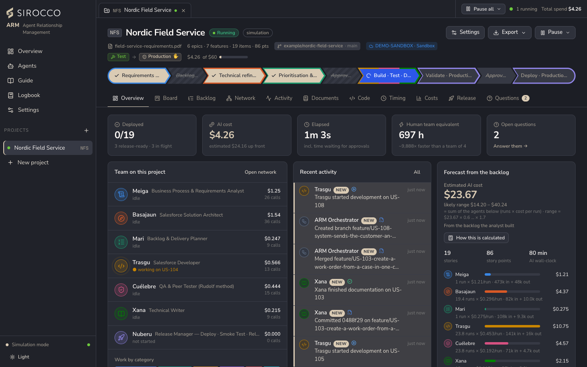
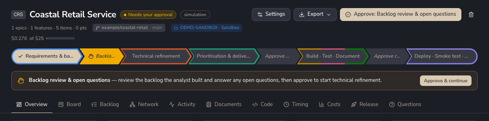
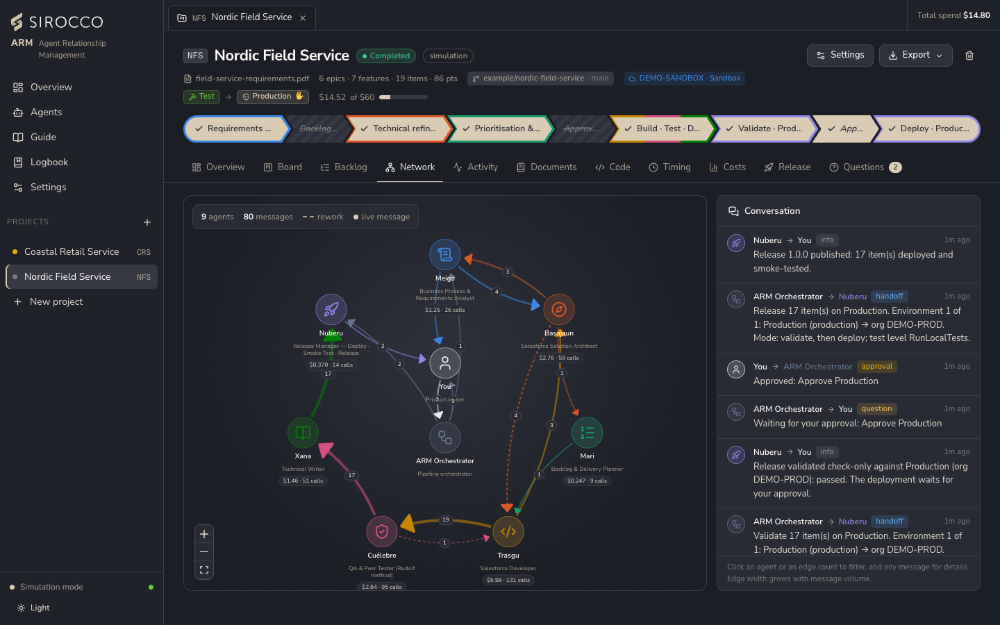

# How it works

Every project runs through the same pipeline. Agents hand work to each other through the project (work items, documents, files and messages), and the pipeline stops at the gates for a person to decide.

## The pipeline

| # | Stage | Owner | What happens |
|---|---|---|---|
| 1 | Requirements | Meiga | Reads the document; creates the project brief, epics, features and stories with acceptance criteria; raises open questions. |
| 2 | **Backlog review** | *You* | Gate: review the backlog and answer the open questions. |
| 3 | Technical refinement | Basajaun | Technical specification per story and the solution design, one feature at a time in parallel. |
| 4 | Prioritisation & delivery plan | Mari | Story points, MoSCoW, WSJF, dependencies, rank and sprints. |
| 5 | **Approve plan** | *You* | Gate: check estimates, priorities and sprints. |
| 6 | Build · Test · Document | Trasgu, Cuélebre, Basajaun, Xana | Per story, in parallel lanes: build, peer test (with rework loops), optional architect code review, documentation, merge. |
| 7 | **Approve release** | *You* | Gate: everything is built, tested and documented. |
| 8 | Deploy · Smoke test · Release | Nuberu | Manifest, validation, smoke tests and versioned release notes. With environments, one step per environment, each with its own optional approval. |

Gates can be switched off per project (autopilot).

The **path bar** at the top of a project shows each stage in the colours of the agents that own it: ✓ done, a spinner while running, a hand while it waits for you, hatched when skipped.

## Questions hold stories

When the analyst finds something ambiguous ("to be decided", "approx."), it raises a question. The story stays in *Requires additional information* while the rest of the backlog carries on. Answer it in the project's **Questions** tab: the agent that asked receives the answer, and after the last answer the story moves to *Ready for Refinement*.

## How agents talk

- **Hand-offs** go through the project: a story card, the developer's hand-over, the files a story changed. Each agent receives only the context its step needs, which keeps token use low.
- **`consult_agent`:** an agent asks another one a question instead of guessing (for example, the developer asks the architect).
- **`ask_human`:** an agent asks you when a business decision is needed.
- Every message is recorded. The **Network** tab draws who talked to whom: dashed edges are rework, animated ones are in flight.

## Simulation and live

**Simulation** runs the real pipeline with scripted agents, without calling Claude:

- The requirements (a PDF or a description) are read locally and turned into a backlog by rules: numbered sections become epics and features, each requirement (a sentence with *must*, *should*, *can*…) becomes a story with persona, category, acceptance criteria and a technical specification.
- The same orchestrator, gates, tools, board, network and timing as a live run are used.
- Code (TypeScript modules with tests, scripts, documents) is generated from templates into a real git repository, with a branch per story and merges.
- Cost: token counts are modelled on what a live call would send (context, cache, reasoning) and priced at real model rates. Nothing is billed.
- The project's checks are not run, and QA evidence (a drawing of the app page) is simulated and labelled as such.

**Live** runs each agent on Claude — your Claude plan through the Agent SDK, or the Claude API with a key — with the PDF attached for the analyst, adaptive thinking and the agent's effort level. The project's checks really run, in the story's worktree.

| Where you see the mode | Simulation | Live |
|---|---|---|
| Top bar, left of Total spend | **Simulation** badge | Red **LIVE** badge |
| Window edges | – | A red line at the top and bottom |
| Live selected but no API key | Amber **Live · no API key**: still simulating | |

A project keeps the mode it was created in. To run live, switch the app to Live first, then create the project.

## Pausing

- **Pause** a project: *Pause after current steps* (nothing is lost) or *Stop now* (running steps are cancelled and run again on resume).
- **Pause all** in the top bar stops every project.
- A project's **budget**, the **daily and monthly spend limits**, and Claude API errors (rate limit, overload, credits, authentication, network) pause the work with a banner that says why. See [Estimates, costs and limits](Estimates-Costs-and-Limits.md).
