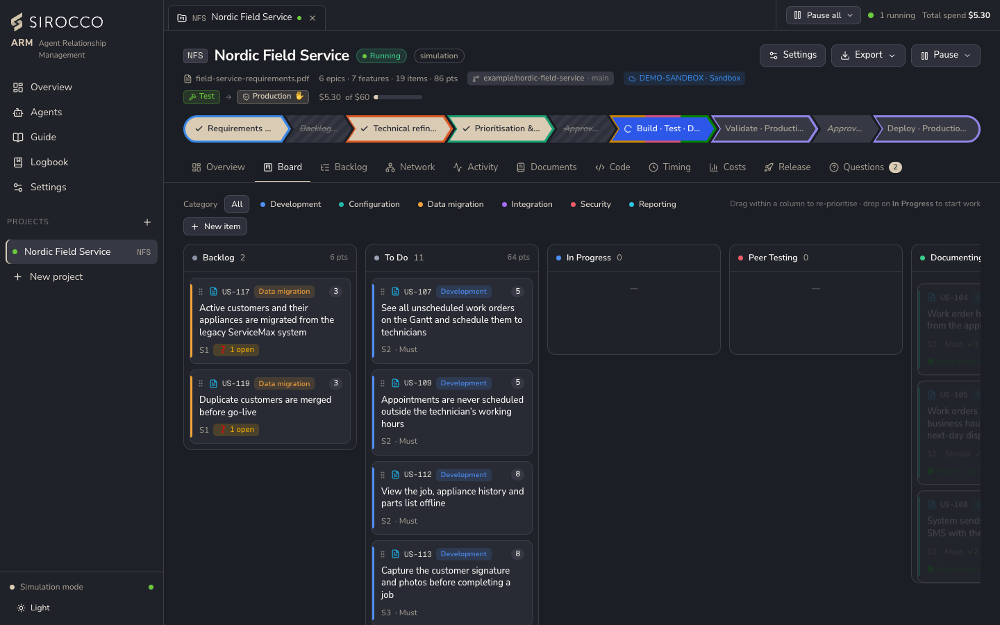
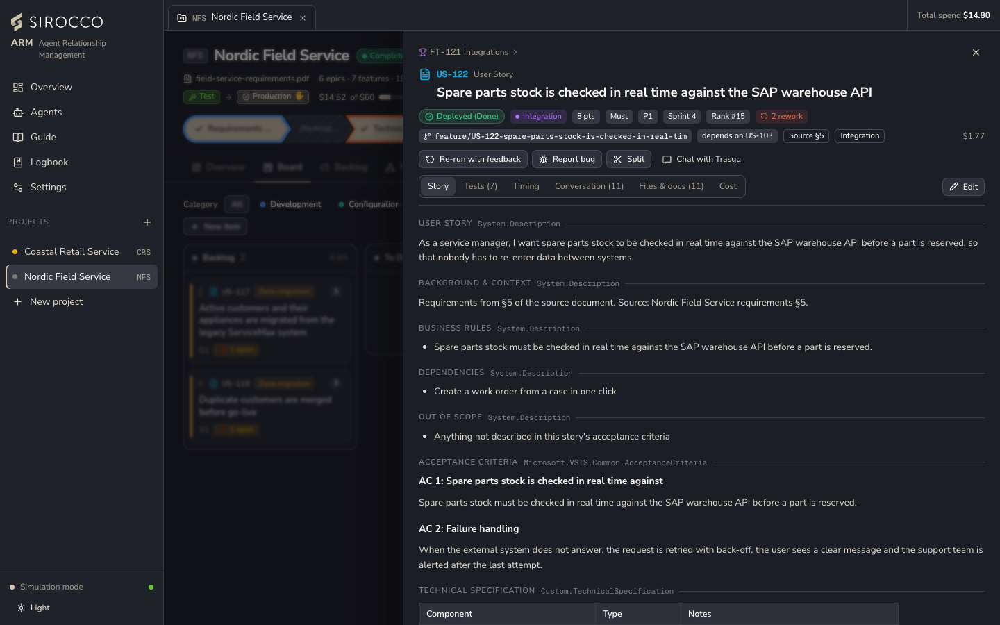

# Projects and backlog

## Creating a project

| Field | Required | Notes |
|---|---|---|
| Requirements | Yes | A PDF (up to 32 MB) or a description in *Context for the team*. Each sentence with "must", "shall" or "should" becomes a story. |
| Name and key | Yes | Suggested from the file name. The short key (for example `NFS`) prefixes item codes. |
| Git repository | Yes | `https://` or `git@` URL without credentials, plus the default branch. *Test connection* checks it without changing the remote. *Push to origin* is opt-in. |
| Team | Yes | At least one agent. A stage without an agent is skipped. |
| Run settings | – | Approval gates, parallel lanes, budget, maximum QA rework, architect code review (Off / Complex stories / All stories), and a target org or an environment chain. |

Required fields are marked with a red **\***. Until they are filled in, a *Still needed: …* line under the buttons says what is missing. **Create & start** runs immediately; *Create without starting* lets you start later.

Each open project gets its own tab: **Overview, Board, Backlog, Network, Activity, Documents, Code, Timing, Costs, Release, Questions**.

## Work items

The model is the same as in Azure DevOps: **Epic → Feature → Story / Task / Bug**. Stories follow the story template: User Story, Background & Context, Business Rules, Dependencies, Out of Scope, Acceptance Criteria, Technical Specification, How to Test, Manual Steps and Solution Components. Each section shows the Azure DevOps field it maps to.

## Board

Columns follow the pipeline: *Backlog* (New, Requires additional information, Ready for Refinement, Ready for Sprint), *To Do*, *In Progress*, *Peer Testing*, *Documenting*, *Release Ready*, *Releasing*, *Done* and *Blocked*.

- Cards move through the pipeline in order; you can't drag a card past a step.
- Drag within a column to re-prioritise. Drop a card on **In Progress** to start it: the right agents run each missing step in order.
- Filter by category. A held card shows its open questions.

The **Backlog** tab shows the hierarchy with category, state, points, MoSCoW, sprint, rank, test results and AI cost per item.

## The item drawer

Click any card or row.

- **Chips:** state, category, points, MoSCoW, priority, sprint, rank, rework count, the task's git **branch**, its **pull request**, its **Azure DevOps** item, dependencies and the source section of the requirements.
- **Tabs:** Story, Tests, Timing, Conversation, Files & docs, Cost.
- **Comments:** every agent that works on the item afterwards reads them.
- **Actions:**
  - *Re-run with feedback* asks one agent (developer, QA, writer, architect or analyst) to redo its part.
  - *Split* moves some acceptance criteria into a new story.
  - *Start work*, *Put on hold*, *Cancel* and *Reopen* change the lifecycle. The state itself is moved by the agents.
  - *Chat* with the agent that built the item.

## Bugs and patch releases

**Report bug** on a delivered story creates a linked Bug. The developer fixes it, QA verifies it, the writer updates the changelog and the release manager publishes a patch release (1.0.0 → 1.0.1).

## Exports

Project header → **Export**:

| Export | Contents |
|---|---|
| Workspace (.zip) | SFDX source, manifest, scripts, all documents and both CSV files. |
| Backlog (CSV) | Every item with all template sections, estimates, states, rework and AI cost. Opens in Excel. |
| Azure DevOps import (CSV) | For *Boards → Work items → Import*; keeps the hierarchy. |
| Project report (PDF) | A branded A4 report: summary, team, backlog, quality, timing, cost, releases and documents. *+ test reports* adds every task document and test report. |
