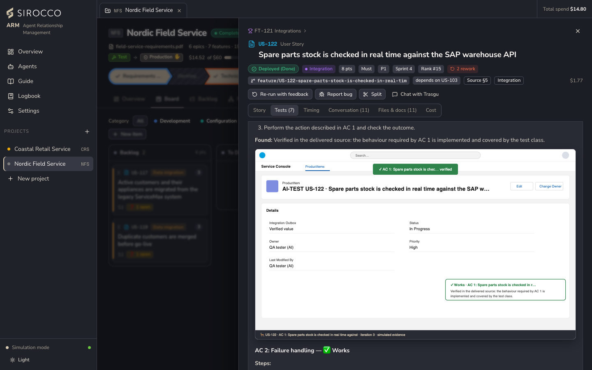

# Quality and code review

Cuélebre peer-tests every story against its acceptance criteria and records evidence. Optionally, Basajaun reviews the code before it is merged.

## The Rudolf method

1. **The ticket is the only source.** Checks are planned from the story's *How to Test*, or from its acceptance criteria and technical specification. If the ticket is too unclear to test, the verdict says exactly what is missing.
2. **Plan** one or more checks per acceptance criterion, including a negative check when the criterion has a condition.
3. **Verdict per check**, with fixed rules:
   - ✅ **Works**, with evidence;
   - ❌ **Broken**, saying what is wrong and where;
   - ⛔ **Couldn't test**, which is not a failure of the story.

   A "works" without evidence becomes ⛔, and a ❌ is never softened.
4. **Overall:** all ✅ means approved. Any ❌ means changes requested: the story goes back to the developer with one finding per ❌. A code review against the standards runs alongside.

Each rework loop counts toward the project's *Max QA rework*. Beyond it the story is marked **Blocked** for a person to review. The item's **Tests** tab shows the checks per iteration and the latest test report (versioned and printable), plus the smoke tests after the release.

## Evidence

| Mode | Evidence |
|---|---|
| Simulation | A drawing of the Salesforce record page the tester checked, with the verified fields and the outcome, and a red box around what is wrong. Labelled *simulated evidence*. |
| Live, with an org | Real screenshots. The Salesforce CLI creates a one-time login link to a page in the org, and a headless Chrome on this computer opens it and takes the screenshot. The link is never logged or stored, and only pages inside the org are allowed. Without Chrome, the drawing is used. |

## Guards in live mode

With an org, the pipeline enforces:

- the developer can't hand a story to QA until its deployment validates in the org;
- QA can't approve until the story's Apex tests pass and the changed classes meet the minimum coverage (*Settings → Team → Salesforce defaults*).

## Architect code review

*Architect code review* is set per project:

| Setting | Reviews |
|---|---|
| Off | No stories. |
| Complex stories | Integration, development and data migration stories. |
| All stories | Every story. |

Basajaun reviews the task branch's diff against the team's review checklist and the solution design, after QA approves and before documentation and the merge. *Changes requested* sends the story back to the developer; QA re-tests and Basajaun reviews again, which counts toward the rework limit. Each review costs one extra architect run, which the estimate includes. A *Code review* phase appears in Timing, and on GitHub the review is posted on the pull request.
