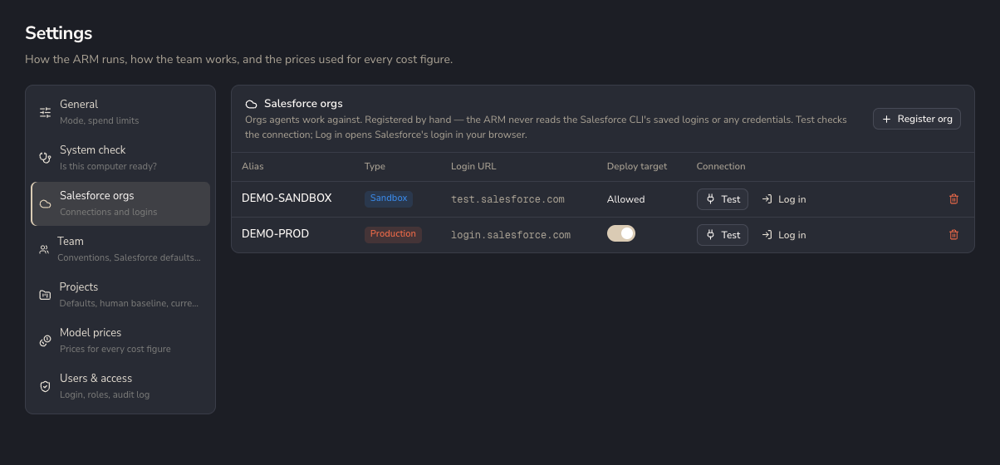
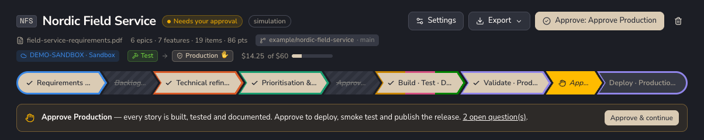
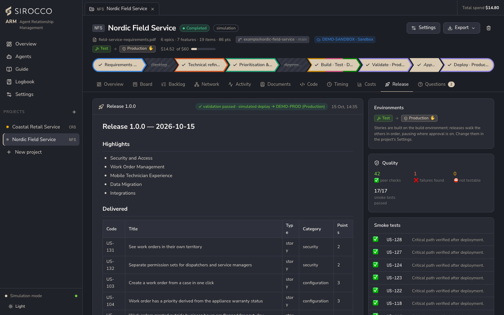

# Salesforce orgs and environments

Orgs are registered by hand and referred to by alias. The Salesforce CLI on this computer keeps the logins; SiroccoARM never sees them.

## Registering an org

1. **Settings → Salesforce orgs → Register org:** alias (for example `CLIENT-DEV`), type (sandbox, scratch, Developer Edition or production) and, optionally, the login URL. Nothing else is stored.
2. **Log in** opens Salesforce's own login page in the browser through the CLI (`sf org login web`). You sign in there and the CLI keeps the session.
3. **Test** runs a read-only query of the org's details (name, edition, instance) to confirm the CLI can reach it.

The alias you register must match the CLI's alias for that org.

## Production orgs

A production org, which includes a Trailhead Playground, is a target only after you switch **Allow** on for it. Even then:

- the developer and QA only validate against it (check-only);
- real deploys happen only in the release step, after approval;
- anonymous Apex never runs on production;
- smoke tests don't run on production.

## Environments

A project uses either a single target org or an ordered chain of environments, each mapped to a registered org.

| Environment | Count | Purpose |
|---|---|---|
| **Build** | One, always first | Where stories are developed, validated and peer-tested. |
| **Stage** | Optional, any number (for example UAT) | A release step before production. |
| **Production** | One, last | The final release. |

Each environment has a deploy mode (deploy, or validate only), a test level and an optional approval. The release walks the stage and production environments in order. Release notes and the git tag are published after the last one.

A production environment that deploys is validated check-only *before* your approval, and the already-validated release is quick-deployed *after* it.

## Simulation vs live

| Step | Simulation | Live |
|---|---|---|
| Developer | Simulated against the org's name; nothing is sent. | Validates each story with its tests (check-only), or deploys it to a sandbox, scratch or developer org if the agent is set to deploy. |
| QA | Static review and drawn evidence. | Runs the story's Apex tests in the org and takes real screenshots. |
| Release | Simulated validation and deploy. | Check-only validation, then deploy. Production after approval, as a quick deploy of the validated release. Smoke tests, except on production. |

The analyst can also read the org's real data model (`describe_object`) and run read-only SOQL in live mode.
