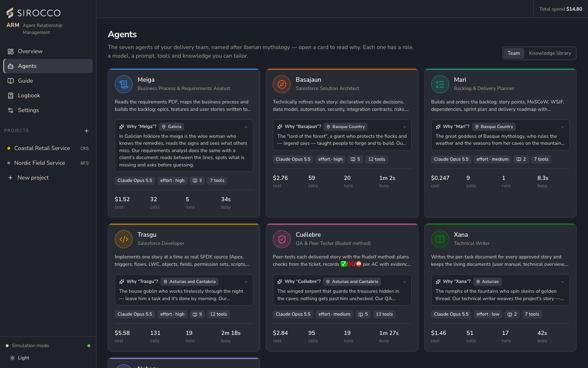
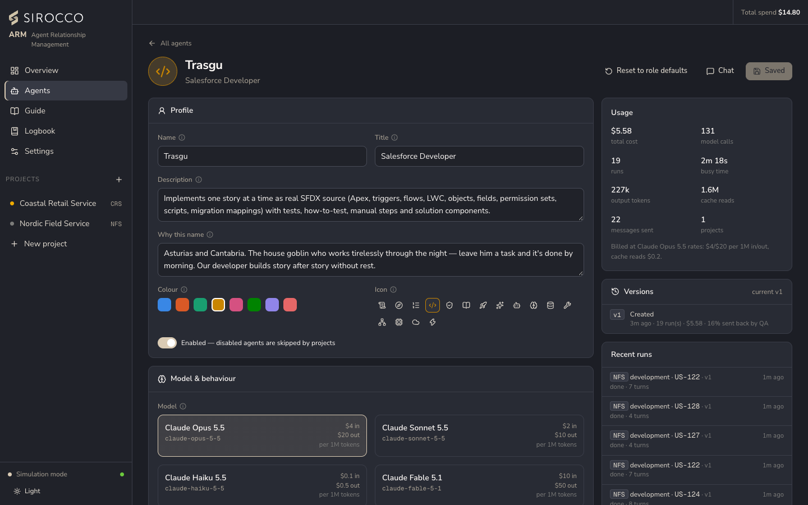
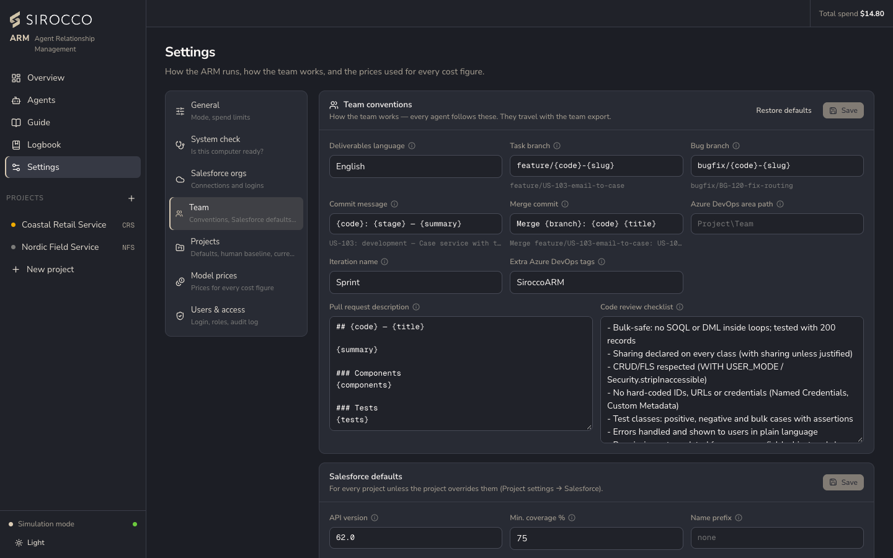

# The agent team

The team has seven agents, one per role. Each one can be tailored (model, effort, knowledge, tools, prompt), and every change is versioned. Creating additional agents is switched off for now.

## Roles

| Agent | Role | Produces |
|---|---|---|
| **Meiga** | Business Process & Requirements Analyst | Project brief; epics → features → stories in the story template, with acceptance criteria, categories and open questions. |
| **Basajaun** | Salesforce Solution Architect | Declarative-vs-code decisions, each story's technical specification, the solution design and, optionally, code reviews. |
| **Mari** | Backlog & Delivery Planner | Story points, MoSCoW, WSJF, dependencies, rank, sprints and the delivery plan. |
| **Trasgu** | Salesforce Developer | SFDX source per story (Apex, triggers, flows, LWC, metadata, scripts) with tests, how-to-test, manual steps and a story manifest. |
| **Cuélebre** | QA & Peer Tester | One ✅ / ❌ / ⛔ verdict per acceptance criterion with evidence, a test report, and approve or send back for rework. |
| **Xana** | Technical Writer | A task document per story, plus the living user manual, technical overview and changelog. |
| **Nuberu** | Release Manager | `package.xml`, validation, smoke tests and versioned release notes with a rollback plan. |

## Why these names

The agents are named after figures of Iberian mythology, each chosen for what its role does. The Agents page has a **Why "…"?** box on every card.

| Agent | Origin | Why |
|---|---|---|
| Meiga | Galicia | The wise woman who reads the signs others miss, as the analyst reads between the lines of a requirements document. |
| Basajaun | Basque Country | The lord of the forest who taught people to build; the architect designs the structure everything stands on. |
| Mari | Basque Country | The goddess of weather and seasons; the planner sets the project's rhythm. |
| Trasgu | Asturias and Cantabria | The house goblin who works through the night; the developer builds story after story. |
| Cuélebre | Asturias and Cantabria | The winged serpent guarding the treasure; nothing reaches a release without QA's approval. Its method is still called the *Rudolf method*. |
| Xana | Asturias | The fountain nymph spinning golden thread; the writer weaves the documents into one clear thread. |
| Nuberu | Asturias and Galicia | The lord of the clouds who decides where the weather falls; the release manager decides when work lands in each environment. |

## Tailoring an agent

Open an agent from the **Agents** page.

| Setting | What it does |
|---|---|
| Profile | Name, title, description, *Why this name*, colour, icon. Disabled agents are skipped by new projects. |
| Model | Opus, Sonnet, Haiku or Fable, with the price per million tokens. All seven agents default to `claude-opus-5-5`. |
| Effort | `low` → `max`: how hard the model thinks. More effort means better reasoning and more output tokens. |
| Max turns | The maximum number of model calls in one run. |
| Knowledge | Role knowledge packs you can switch on and off, plus **custom knowledge**: your own Markdown, always applied and taking priority over the packs. Shared packs live in *Agents → Knowledge library*. |
| Prompt and tools | The core instructions and the tools the agent may call. The developer and release agents also have Salesforce settings: default target org, check-only or deploy, test level. |
| Versions | Every change to prompt, knowledge, tools or model creates a version with its runs, cost and QA rework rate. Compare any version with the current one and restore it. |

*Reset to role defaults* restores the built-in definition. **Chat** lets you ask the agent questions; it answers from its real runs, costs and knowledge.

### Built-in knowledge packs

Stored in `server/knowledge/`: the story template, the DevOps workflow, the Rudolf peer-testing method and Salesforce engineering standards for Apex, Flow, LWC, SOQL, testing, metadata, integration, data migration, release management and documentation.

## Team settings

**Settings → Team** holds what every agent follows:

- **Conventions:** deliverables language, branch, commit and merge formats, the pull request description, the code review checklist, and Azure DevOps area, iterations and tags.
- **Salesforce defaults:** API version, minimum coverage, name prefix, namespace and which tests run when a story is validated. Each project can override them.
- **Export & import the team:** the whole team as one JSON file (agents, custom knowledge, conventions, Salesforce defaults, project defaults, model prices) to move it to another computer. Import shows a preview first. API keys, org aliases, logins, git credentials, spend limits and the mode are never included.

